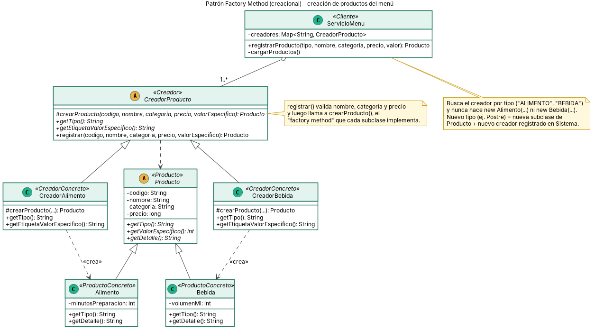
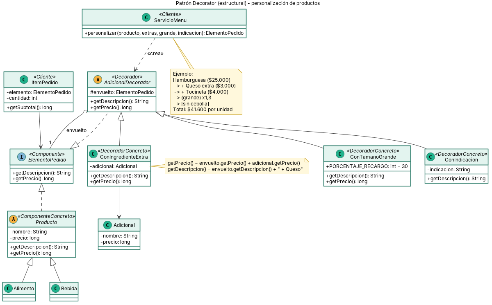
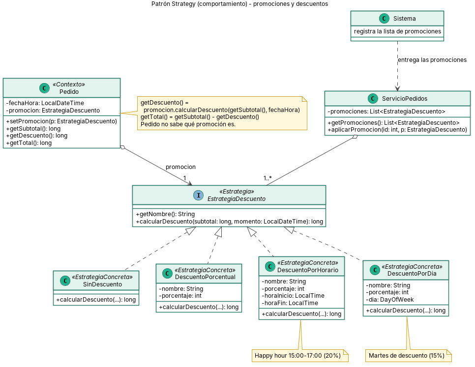

# Documento de diseno — Restaurant Manager

> Este documento es una **plantilla con los datos tecnicos ya completos** (clases y roles).
> Las secciones marcadas con ✍️ deben escribirse **con palabras propias del equipo**:
> el enunciado lo exige y es lo que se pregunta en la sustentacion.

## 1. Arquitectura general

```
consola ─┐
         ├──► servicio ──► modelo + patrones
gui ─────┘        └──────► persistencia (CSV)
```

- `Sistema` crea los servicios una sola vez; `AppConsola` y `AppGUI` hacen `new Sistema()`.
- La consola y la ventana solo llaman metodos de `ServicioMenu`, `ServicioPedidos` y `ServicioReportes`.
- ✍️ Expliquen por que esta separacion evita duplicar codigo y que pasaria si la ventana calculara precios. 
Separamos la interfaz gráfica de la lógica del negocio con el fin de evitar duplicar líneas de código, de modo que, al calcular el valor de precios, descuentos y totales, no se repita en diversas pantallas, sino que se centralice en el modelo y los servicios. Si la misma ventana calculara el valor de los precios directamente, todo esto estaría ligado a la interfaz, habría que repetir el mismo código en las distintas pantallas del programa, lo que nos daría un programa muy pesado con repetitivas líneas de código que hacen la misma función; y no solo ello, sino que al tener esa programación tendríamos que modificar todas las líneas del código en las diversas pantallas cuando queramos anexar un cambio.

## 2. Problemas de diseno

| # | Situacion del sistema | Diseno ingenuo y su problema | Patron |
|---|---|---|---|
| 1 | Crear alimentos y bebidas desde la consola, la ventana y el CSV | `switch (tipo) { case "ALIMENTO": new Alimento(...) }` repetido en tres lugares; un tipo nuevo obliga a editar los tres | Factory Method |
| 2 | Hamburguesa con queso, tocineta, grande y "sin cebolla" | Una subclase por combinacion (`HamburguesaConQuesoYTocineta`...) o muchos `if` para sumar precios | Decorator |
| 3 | Promociones por porcentaje, horario y dia | `if (dia == MARTES) ... else if (hora entre 15 y 17) ...` dentro de `Pedido`; cada promocion nueva modifica `Pedido` | Strategy |
| 4 | Avisar a cocina, mesero y caja cuando cambia el estado | `cambiarEstado()` llama a `cocina.avisar()`, `caja.avisar()`...; agregar un destinatario modifica el pedido | Observer |

✍️ Para cada problema escriban un ejemplo concreto con sus palabras (como lo explicarian a alguien del restaurante).
Imagina que por un día a la semana le vas a poner a tus hamburguesas una promoción de 2x1: tus clientes estarán demasiado satisfechos, pero a la hora de cobrar, el cajero no ve esa opción en la pantalla, y solo fue porque a la hora de codificar no actualizaron justo en esa pantalla esa nueva actualización. El cajero tendrá confusión, no sabrá qué cobrar o cómo hacerlo porque su programa no le da esa opción, y nos toca ingresar directamente a cambiar línea por línea de código en cada pantalla. Con mi solución es más efectivo: tenemos los datos de cobro y para ese día solo anexamos sin tocar nada de código anterior, sin modificar o dañar todo lo hecho anteriormente; solo anexamos la nueva promoción. Al separar, tenemos la misma regla de cobro y todas las pantallas usarán el mismo resultado sin necesidad de modificar una a una.

## 3. Patrones aplicados

### 3.1 Factory Method (creacional)

| Rol del patron | Clase del proyecto |
|---|---|
| Producto | `Producto` |
| Productos concretos | `Alimento`, `Bebida` |
| Creador (con el *factory method* `crearProducto`) | `CreadorProducto` |
| Creadores concretos | `CreadorAlimento`, `CreadorBebida` |
| Cliente | `ServicioMenu` (registra y carga productos sin `new Alimento` directos) |



- ✍️ Descripcion del patron con palabras propias.
Este patrón nos sirve para delegar o ayudarnos en el proceso de creación de los objetos en clases específicas directamente donde los vamos a utilizar, de manera que el sistema trabaje sobre una misma estructura y, a la hora de querer anexar cambios o mejoras, nos permita hacerlo simplemente creando una nueva clase propia, sin tener que reescribir todas las líneas del código anterior; este patrón nos permite un código con más alcance y más escalable, con mayor facilidad a mejoras y adaptaciones.

- **Alternativa considerada:** Fabrica simple con `switch`. Se descarto porque un tipo nuevo obliga a editar la fabrica.

- ✍️ Ventajas y desventajas (pista: mas clases vs. extensibilidad).
Ventajas: Con este enfoque tratamos de que el código tenga mayor adaptabilidad, sea mucho más extensible y más fácil de mantener cuando haya nuevas actualizaciones o cambios, permitiendo que el código principal siga funcionando correctamente incluso cuando se le agreguen nuevos cambios, ya que no está "amarrado" a implementaciones concretas.

Desventajas: Su mayor desventaja es que aumenta la cantidad de clases que se crean en este, haciendo una estructura mucho más larga y que parezca más compleja, pero al final sigue siendo el mismo proyecto pequeño, aunque mejor estructurado.
- **SOLID:** Abierto/Cerrado (tipo nuevo = clase nueva), Responsabilidad unica (cada creador sabe fabricar un tipo), Inversion de dependencias (`ServicioMenu` depende de `CreadorProducto`, no de las clases concretas).
- **Cambio en vivo — nuevo tipo `Postre`:** crear `Postre extends Producto`, `CreadorPostre extends CreadorProducto` y agregar `new CreadorPostre()` en `Sistema`. La consola y la ventana lo muestran solas.

### 3.2 Decorator (estructural)

| Rol del patron | Clase del proyecto |
|---|---|
| Componente | `ElementoPedido` (interfaz) |
| Componente concreto | `Producto` (`Alimento`, `Bebida`) |
| Decorador | `AdicionalDecorador` |
| Decoradores concretos | `ConIngredienteExtra`, `ConTamanoGrande`, `ConIndicacion` |
| Cliente | `ServicioMenu.personalizar()`, `ItemPedido` |



- ✍️ Descripcion del patron con palabras propias (pista: "envolver" como capas de una cebolla).
Este patrón nos sirve para agregar nuevas funcionalidades a nuestro código principal, de manera que parezca como capas de una cebolla: el código fuente o principal en el núcleo, y cada capa nueva como una capa de la cebolla. Agregamos nuevas funcionalidades sin tocar el núcleo; así podemos anexar comportamientos extras de manera flexible sin alterar el código original.
- **Alternativa considerada:** guardar una lista de adicionales dentro del item. Es valida, pero cada nuevo tipo de extra (tamano, indicacion) obligaria a cambiar los calculos de `ItemPedido`.
- ✍️ Ventajas y desventajas (pista: muchos objetos pequenos, el orden de envoltura importa con el tamano grande).
Ventajas: Permite añadir o combinar comportamientos extra de manera flexible sin modificar el núcleo ni el código ya existente, eligiendo solo las capas que se necesiten en cada caso.

Desventajas: Puede generar bastantes objetos pequeños envolviéndose entre sí, lo que hace el seguimiento más largo, y el orden en que se aplican las capas importa —por ejemplo, si se maneja un tamaño grande, no da lo mismo aplicarlo antes o después de otro ajuste o cálculo.
- **SOLID:** Abierto/Cerrado, Responsabilidad unica (cada decorador suma una sola cosa), Sustitucion de Liskov (un producto decorado se usa igual que uno sin decorar).

### 3.3 Strategy (comportamiento)

| Rol del patron | Clase del proyecto |
|---|---|
| Estrategia | `EstrategiaDescuento` (interfaz) |
| Estrategias concretas | `SinDescuento`, `DescuentoPorcentual`, `DescuentoPorHorario`, `DescuentoPorDia` |
| Contexto | `Pedido` (usa `promocion.calcularDescuento(...)`) |




- ✍️ Descripcion del patron con palabras propias.
Este patrón nos sirve para tener varias formas de solucionar un problema o una misma tarea; es decir, como aplicar distintos tipos de descuentos en clases separadas, todo bajo una misma estructura de código, para que el pedido pueda usar o cambiar las estrategias según las necesidades, sin tener que llenar de condiciones adicionales ni tocar código ya funcional.
- **Alternativa considerada:** `switch`/`if` en `Pedido`. Se descarto porque mezcla reglas de marketing con el calculo del pedido.
- ✍️ Ventajas y desventajas.
Ventajas: Permite sumar nuevas promociones de descuentos creando una clase nueva que implemente EstrategiaDescuento; esta se registra en el Sistema sin tener que modificar Pedido. Esto nos ayuda a no llenar el código de condiciones, favoreciendo los principios Abierto/Cerrado y Responsabilidad única.

Desventajas: Aumenta la cantidad de clases en el proyecto por cada tipo de promoción y requiere conocer el sistema para ir seleccionando la estrategia adecuada.
- **SOLID:** Abierto/Cerrado, Responsabilidad unica, Inversion de dependencias (`Pedido` depende de la interfaz).
- **Cambio en vivo — nueva promocion:** crear una clase que implemente `EstrategiaDescuento` y agregarla a la lista de promociones en `Sistema`.

### 3.4 Observer (comportamiento)

| Rol del patron | Clase del proyecto |
|---|---|
| Sujeto | `ServicioPedidos` (`agregarObservador`, `quitarObservador`, `notificar`) |
| Observador | `ObservadorPedido` (interfaz) |
| Observadores concretos | `NotificadorCocina`, `NotificadorMesero`, `NotificadorCaja`, `PanelCocina`, `PanelPedidos` |

- ✍️ Descripcion del patron con palabras propias.
Este patrón notifica a los interesados o suscritos en el modelo —es decir, meseros, cajeros, cocineros, etc.—; notifica a las personas los cambios importantes en el sistema de manera automática, sin que el servicio sepa los detalles internos de cada uno.

- **Alternativa considerada:** llamadas directas desde `cambiarEstado()`, o que cada pantalla consulte cada cierto tiempo (polling). Se descarto por acoplamiento y desperdicio.
- ✍️ Ventajas y desventajas (pista: el orden de aviso no esta garantizado; un observador lento afecta a todos).
Ventajas: Mandará las notificaciones de manera automática a cada miembro del sistema sin necesidad de enterarse de procedimientos internos que haya en el sistema, permitiendo que, si se anexa un nuevo miembro, solo baste con suscribirlo sin modificar el código del servicio.

Desventajas: Si hay muchos suscriptores u observadores, se puede volver más difícil seguir en qué orden se avisará a los observadores, y cuando alguien se retire, tendrá que quitar de manera manual las notificaciones a ese miembro.
- **SOLID:** Abierto/Cerrado (nuevo destinatario sin tocar el sujeto), Inversion de dependencias.
- **Cambio en vivo — avisar al administrador:** crear `NotificadorAdministrador` y registrarlo en `Sistema`.

## 4. Conclusiones

✍️ Que aprendimos, que fue lo mas dificil y que cambiariamos del diseno (por ejemplo: promociones acumulables con el patron Composite, o combos con Builder).
Qué aprendimos: Aprendimos con mi equipo a organizar de una manera más efectiva los diseños del sistema, separando la interfaz gráfica de la lógica del negocio y aplicando patrones de diseño (como Factory Method, Decorator, Strategy y Observer) para ordenar el código de manera más estructurada y clara, para ayudarnos a que, cuando queramos agregar, cambiar, anexar o modificar el código, nos resulte de manera más fácil y óptima. También reforzamos el trabajo en equipo con Git para coordinar cambios y documentación.

Qué fue lo más difícil: Fue entender o adaptarnos a dónde empieza y termina cada responsabilidad en cada clase y en cada patrón, para así evitar mezclar reglas del negocio con las pantallas de creación, y coordinar los avances del equipo para que todo encajara sin conflictos.

Qué cambiaríamos del diseño: Si volviéramos a plantear el diseño o lo ampliáramos, incorporaríamos patrones como Composite para manejar promociones o reglas acumulables de forma jerárquica, y Builder para armar combos o pedidos complejos paso a paso de manera más clara y controlada.
